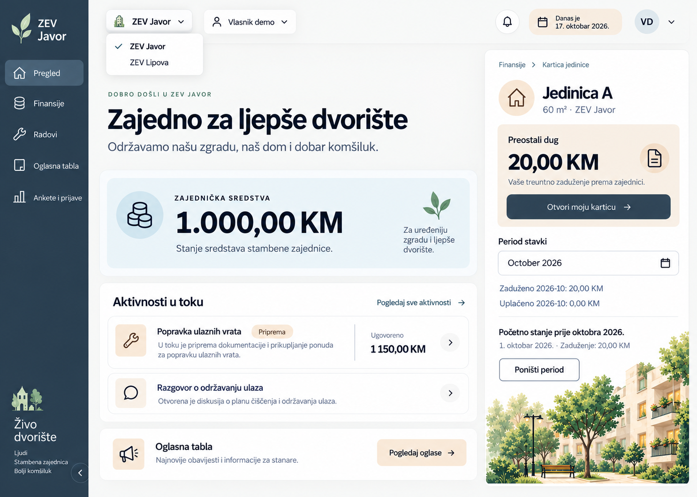

# Plan dodatne UI revizije — paneli i moderni select

Datum: 17. oktobar 2026. (Europe/Belgrade). Faza: DEV-02-K, nakon postojeće dorade DEV-02-J.

Status: **PAUZIRANO** — 17. oktobra 2026. korisnik traži preskakanje preostalih K-B–K-E i povratak kasnije. Primijenjeni tokeni/komponente i select ostaju sačuvani sa ranijim provjerama. Preostaju K-B responsive/200% tekst/fokus, puna K-C matrica, K-D ekrani i K-E završna provjera/pregled. Nastavak tek na novu instrukciju; ranija odobrenja i izvedbeni zapisi ispod ostaju istorija.

## Potvrđeni izbor i prednost uputa

Tačna referenca je `ui-revizija-varijacije/dashboard-2.png`, Image Gen rezultat `exec-464c0615-640b-4450-afd1-744cc2c3be54.png`, druga slika prikazana u posljednjoj seriji. Nije `ui-revizija-primjeri/dashboard-2.png` iz prethodne serije. Korisnik je 17. oktobra 2026. potvrdio izbor i zatražio spreman plan.

Ovaj izbor ima prednost nad ranijim zahtjevom da se topla paleta zadrži bez promjene i nad petrolej/zelenim tokenima „Živog dvorišta“. Raniji plan i slike ostaju istorija. Zadržati toplinu ilustracije i pješčanih naglasaka, uz novu slate navigaciju i blago plavu površinu sredstava. Nijedna slika ne mijenja poslovna pravila.

## Specifikacija za izvedbu

### Tokeni

Vrijednosti su polazna specifikacija za odabrani izgled, ne tvrdnja da su očitane iz svakog piksela reference. U K-B izmjeriti stvarne kombinacije, po potrebi korigovati radi kontrasta i evidentirati korekciju.

| Token / namjena | Početna vrijednost |
|---|---|
| canvas | `#F5F6F5` |
| surface | `#FFFFFF` |
| ink | `#162432` |
| muted | `#52616F` |
| sidebar / accent | `#293E50` |
| sidebar-active | `#405D72` |
| accent-hover | `#203242` |
| funds-surface | `#E8EFF3` |
| balance-surface | `#F1E5D6` |
| warm-action-surface | `#EED9BE`, uz ink tekst |
| line, dekorativni rub | `#DCE2E6` |
| control, potrebna granica | `#758391` |
| focus | `#293E50` |
| focus-inverse | `#F1E5D6` |

Danger/success/warning zadržavaju postojeće semantičko značenje; njihove vrijednosti provjeriti na novim površinama. U kodu preimenovati ili mapirati stare mint/peach tokene prema namjeni, bez ostavljanja dvije aktivne palete. Bez tamne teme i bez novih fontova. Postojeće Tabler ikone i sistemski sans ostaju.

Paneli: radius 20–24 px; kontrole 12–16 px; kratki statusi kapsule. Razmaci 8/12/16/24/32 px; glavne površine padding 24 px na desktopu i 16 px na telefonu. Osnovni tekst 16 px, pomoćni 14 px; naslov 36–44 px desktop / 28–32 px telefon, iznos sredstava 44–52 px desktop / 32–36 px telefon. Koristiti rem i prelamanje, bez fiksne visine koja odsijeca sadržaj.

Dubina: obični panel prvenstveno razdvojen pozadinom i tankim rubom; početna diskretna sjenka `0 4px 20px rgb(41 62 80 / 5%)`. Otvoreni select dobija jaču sjenku `0 12px 32px rgb(41 62 80 / 14%)`. Bez zamućivanja finansijskih podataka ili sjene na svakom redu.

### Raspored i prilagođavanje profilima

- Široki prikaz oko 1440 px: navigacija približno 208–224 px; zaglavlje iznad sadržaja; glavni pregled i desni sažetak približno u odnosu 1,7:1, desni panel najmanje oko 20rem ako prostor dozvoljava. Ovdje prednost ima raspored izabrane slike, umjesto ranijeg predloga spoljašnjeg zaobljenog app okvira.
- Glavna kolona: dobrodošlica, naslov i kratak podnaslov; zatim sredstva sa stvarnim datumom osnove/usaglašavanja; postojeći radovi, posljednji troškovi i obavještenja. Pregled ne gubi troškove ili druge postojeće informacije zato što ih slika ne prikazuje.
- Vlasnik: desni **sažetak** jedinice, površine i trenutnog Dug/Avans/Saldo, sa linkom na postojeću rutu pune kartice. Ovo namjerno mijenja raniji plan da se kartica uopšte ne pojavljuje desno: detaljna kartica i dalje ima zasebnu rutu, desno se prikazuje samo sažetak. Ne kopirati breadcrumb pune kartice, period filter ili „Poništi period“ na pregled.
- Operater: desni panel prikazuje samo postojeće dozvoljene kartice/prečice, glavna radnja „Dodaj trošak“; ne predstavljati sve jedinice kao njegov lični dug. Korisnik prostora: umjesto kartice dozvoljeni sažetak sopstvenih prijava i postojeća radnja za prijave. Ne dodavati podatke ili prava.
- Na srednjim širinama, kada kolone nemaju dovoljno prostora, vlasnički sažetak prelazi ispod sredstava i prije sporednih lista. Na telefonu: postojeći označeni Meni, zaglavlje i selecti se prelamaju, jedna kolona, padding 16 px, bez sticky panela. Fokus i čitljivi iznosi imaju prednost nad sličnosti desktop slici.
- Ilustraciju zadržati u donjem dijelu desnog sažetka, bez prekrivanja teksta; na telefonu smanjiti ili izostaviti dekoraciju. Prvo koristiti postojeći `courtyard.webp`, uz odgovarajući crop. Ne koristiti screenshot kao UI pozadinu.

### Obavezne ispravke generisanog sadržaja

- Javor počinje sa 1.000 KM; Lipa sa 500 KM, naziv je **Lipa**, ne „Lipova“.
- Jedinica A: početni dug 20 KM; to nije novo oktobarsko zaduženje. Novi oktobarski unosi su 0/0 dok korisnik ne napravi lokalnu promjenu. Vrijednosti izvesti iz postojećih selektora; ne hardkodirati reference.
- „Živo dvorište“ ostaje istorijski naziv smjera; brend je ZEV. Nema zvona, avatar menija, novog chata, univerzalne stranice svih aktivnosti ili novih funkcija sa slike.
- Sastanak/razgovor je postojeće obavještenje, ne nova diskusija. Linkovi vode u postojeće module. Datum formatirati postojećim formatterom, bez engleskog „October“ u custom tekstu.
- Napomena o sintetičkim podacima, Demo prava, reset/izlaz i postojeće potvrde ostaju dostupni iako ih mockup izostavlja.

### Mapa izvedbenih izmjena

Sve lokacije ispod su unutar `apps/web/src`; detaljno stanje provjeriti neposredno prije izvedbe.

| Podfaza | Fajlovi / rezultat |
|---|---|
| K-B | `app/global.css`, `components/ui/button.tsx`, `text-field.tsx`, `notice.tsx`, `page-heading.tsx`: zajednički tokeni i površine, bez dupliranih lokalnih paleta. |
| K-C | Novi `components/ui/select.tsx` i uski field omotač po potrebi; četiri grupe migracije navedene niže; `app/ui/` prikazuje relevantna stanja. |
| K-D | `features/demo/demo-frame.tsx`, `demo-navigation.tsx`, `demo-controls.tsx`, `demo-preview.tsx`, `demo-sections.tsx`: novi okvir i sažetak. `features/demo/finances/finance-details.tsx` zadržava punu karticu; finance/community/work prikazi i `app/page.tsx` usklađuju izgled. |
| K-E | Postojeće komande i ručni scenariji; sačuvati reprezentativne screenshotove i izvještaj sa razlikama reference/implementacije i granicama provjere. |

Prije K-C izabrati održavani select primitive prema zvaničnoj dokumentaciji i stvarnom stanju paketa; ovo je jedina preostala tehnička izvedbena odluka, ne novo pitanje o dizajnu. Obavezni kriterijumi su kontrolisana vrijednost, pristupačna labela, greška/required, fokus validacije, kucanje za izbor, tastatura, portal/položaj i mobilni dodir. Ako paket ne pokriva zahtjeve, ne improvizovati ponašanje u svakom ekranu. Zapisati odluku prije instalacije i provjeriti lockfile.

## Namjera i vizuelni smjer (istorijski početni zahtjev)

Korisnik želi osjećaj priloženog dashboarda, bez kopiranja boja. Referenca je slika priložena u chatu 17. oktobra: tamni dashboard sa zaobljenim spoljnim okvirom, grupisanim panelima, kapsulastim kontrolama i diskretnom dubinom. Prilog nije izvor novih funkcija ili poslovnih pravila.

Preuzeti smiren, kompaktan i precizno složen izgled: jasne grupe sadržaja, usklađena zaobljenja, tanak rub sa blagim osvjetljenjem i meka sjenka. Početno je predloženo krem platno, petrolej navigacija i zelene/kajsija nijanse; konačni izbor iznad zamjenjuje tu paletu slate-and-sand tokenima. Ne preuzimati crnu/ljubičastu paletu, slabu čitljivost sitnog teksta, dekorativne orbite, fintech sadržaj ili raspored svih modula na jednom ekranu.

Pregled treba prvo odgovoriti koliko zajednica ima sredstava i gdje korisnik nastavlja. Kartica prvo prikazuje Dug/Avans/Saldo i jedinicu. Forme prvo objašnjavaju unos i sljedeću radnju. Dekoracija podržava te prioritete.

## Promjene izgleda

| Dio | Planirana revizija |
|---|---|
| Okvir aplikacije | Na širokom ekranu pratiti izabranu referencu: uska navigacija i dvije sadržajne kolone, bez obaveznog spoljašnjeg app okvira; zadržati pet destinacija. Na telefonu koristiti punu širinu bez duplih rubova i nepotrebnog unutrašnjeg okvira. |
| Zaglavlje | ZEV/profil kao usklađena grupa kontrola; sekundarne demo radnje vizuelno tiše. Napomena o privremenim podacima i pristup pravima ostaju vidljivi. |
| Površine | Uvesti zajedničke tokene za blagu sjenku, rub i nivo površine. Početni cilj: paneli 20–24 px, kontrole 12–16 px; kapsule za kratke filtere i navigacione oznake. Provjeriti u stvarnom rasporedu. |
| Hijerarhija | Ujednačiti unutrašnji padding i poravnanje naslova/radnji. Krupni iznosi, tabularne cifre i mirniji sekundarni tekst. Liste ostaju redovi; bez kartice oko svakog podatka. |
| Dugmad i polja | Ujednačiti visinu oko najmanje 44 CSS px, rub, fokus i razmake. Kapsulast izgled koristiti selektivno; višeredna polja i duži tekst ostaju prirodno zaobljeni pravougaonici. |
| Ilustracija | Zadržati postojeći resurs dvorišta, uz manju dominaciju gdje potiskuje podatke. Nisu potrebni novi generisani resursi ili fontovi. |
| Pokret | Kratki prelazi oko 120–180 ms, bez pomjeranja sadržaja; poštovati smanjen pokret. Sadržaj i forme imaju stabilne neprozirne podloge. |

## Moderni select kao zajednička komponenta

Cilj je stilizovan zatvoren select i otvoreni meni koji pripada istom vizuelnom sistemu. Trenutno nema zajedničke select komponente: kontrole su native select elementi sa ponovljenim klasama.

Predložena podjela: mala zajednička `Select` komponenta i omotač `SelectField` za vidljivu labelu, pomoć i grešku. Vrijednost ostaje kontrolisana postojećim stanjem. Ne implementirati kompletnu pristupačnost ručno ako odgovarajući održavani primitive može pouzdano pokriti ponašanje; pri izvedbi prvo provjeriti postojeće pakete i zvaničnu dokumentaciju kandidata, pa zapisati izbor i razlog prije dodavanja zavisnosti. Konkretan paket ovim planom nije izabran niti instaliran.

- Zatvorena kontrola: vidljiva labela, čitljiva vrijednost, desno poravnat chevron i jasan fokus. Ikona samo ako pomaže razlikovanju ZEV-a/profila; placeholder nije labela.
- Otvoreni meni: puna površina, zaobljen rub i meka sjenka, razmak od triggera, jasno označen izabrani red sa kvačicom. Hover, fokus i izabrano stanje razlikuju se; boja nije jedina oznaka.
- Ponašanje: otvaranje tastaturom, strelice, Home/End, izbor kucanjem, potvrda Enter/Space, Escape bez promjene i očekivani Tab izlaz. Pomjeranje kroz opcije ne smije samo potvrditi promjenu ZEV-a ili statusa.
- Dugi nazivi i male širine: meni se prilagođava prostoru i otvara iznad kontrole kad treba; ograničena visina i unutrašnji skrol. Cijeli naziv mora biti dostupan, bez odsijecanja važnih riječi.
- Stanja: podrazumijevano, hover, fokus, otvoreno, izabrano, disabled, greška i prazan skup opcija. Povezati labelu, opis i grešku; podržati postojeći required i fokus validacije.
- Kratke liste bez polja za pretragu. Pretraživi combobox razmatrati tek kada stvarna dužina liste radova ili jedinica opravda dodatnu složenost.
- Mobilno: prvo provjeriti isti primitive dodirom i čitačem ekrana. Ako zahtijeva native alternativu, dokumentovati razliku i očuvati vrijednost, labelu i validaciju; ne obećavati identičan sistemski popup na svim uređajima.

### Obavezne lokacije migracije

| Lokacija | Izbori / očuvano ponašanje |
|---|---|
| `features/demo/demo-controls.tsx` | ZEV i profil; potvrda odbacivanja nacrta, Escape i odustajanje ostavljaju prethodni kontekst. |
| `features/demo/finances/finance-form.tsx` | Jedinica, kategorija i opcioni povezani rad; očuvati validaciju i „Bez povezivanja“. |
| `features/demo/finances/finance-list.tsx` | Filter kategorije; očuvati „Sve kategorije“, URL/filter stanje i poništavanje. |
| `features/demo/community-ui.tsx` | Status prijave; jedinstvena pristupačna labela po prijavi i samo postojeći dozvoljeni statusi. |

Prije završetka pretražiti cijeli `apps/web/src` za preostale selecte. Datum i mjesec nisu obični selecti i ne zamjenjuju se ovim zadatkom.

## Redoslijed i kriterijumi

| ID | Rezultat | Kriterijum završetka |
|---|---|---|
| DEV-02-K-A | Ovaj plan | Izbor posljednje varijacije 2 tačno povezan; tokeni, raspored/profili, ispravke podataka, select ponašanje, mapa fajlova i provjere spremni. |
| DEV-02-K-B | Tokeni i komponente | Usklađeni global.css, dugmad, polja i paneli; reprezentativni pregled na `/ui`, kontrast i fokus provjereni. |
| DEV-02-K-C | Moderni select | Odabran i dokumentovan primitive; jedna komponenta primijenjena na sve navedene lokacije, prikazana stanja na `/ui`, očuvane potvrde i validacija. |
| DEV-02-K-D | Ekrani | Najprije okvir, pregled i kartica kao reprezentativan smjer; zatim finansije/forme, radovi, tabla, ankete/prijave, prava i landing. Dosljedna geometrija i hijerarhija uz očuvan sadržaj. |
| DEV-02-K-E | Provjera i pregled | Lint/typecheck/build, ručni scenariji i screenshotovi sa navedenim granicama; zasebno evidentirati korisnikov pregled. |

Izvedba K-B–K-E je predložena, nije započeta ovim zahtjevom za plan. Ne završavati ili ponavljati J provjere bez razloga; prije izvedbe provjeriti stvarno stanje J i novu reviziju evidentirati zasebno.

## Plan provjere

- Screenshotovi pregleda, kartice, forme i otvorenog selecta na 320, 360, 768 i 1280/1440 CSS px; povećanje teksta 200%, duge opcije i veći iznosi. Bez širenja stranice ili prekrivenih kontrola.
- Select tastaturom i dodirom: otvaranje, navigacija, potvrda, Escape, Tab, skrol i položaj menija. Provjera naziva, vrijednosti i stanja čitačem ekrana u dostupnom okruženju; navesti uređaj/browser i šta nije provjereno.
- Javor/Lipa i sva tri profila, promjena konteksta sa nacrtom, odustajanje, potvrda i reset. Otvoren meni ne smije ostati sa opcijama prethodnog konteksta.
- Finansijski filteri, obavezno/opciono polje, fokus greške i očuvan unos; status prijave se mijenja tek potvrđenim izborom. Kratak prolaz postojećih pogođenih lokalnih tokova bez izmjene poslovnih pravila.
- Kontrast teksta najmanje 4,5:1, velikog teksta 3:1 i potrebnih granica/fokusa 3:1 u stvarnim kombinacijama. Posebno izmjeriti selected, hover, invalid i tamnu navigaciju.
- Postojeće lint/typecheck/build komande. Bez pisanja testova ili dodavanja testne infrastrukture.

Rezultat ovog koraka je dokumentacioni plan na osnovu priložene slike i pregleda koda; živa aplikacija nije vizuelno pregledana u ovom zadatku i nisu izvršene nove runtime provjere. Nema promjene backenda, pravila pristupa, finansijskih obračuna, trajne pohrane ili objavljivanja.

## Početak izvedbe — 17. oktobar 2026.

Posljednja instrukcija odobrava početak K-B–K-E; ranije formulacije o čekanju instrukcije opisuju status pri planiranju. K-B je U TOKU, detalji implementacije, provjera i preostalog rada su u [evidenciji](../napredak.md). Tabler već postoji; nova instalacija nije bila potrebna.

## Izvedba selektora i blagi gradijenti — 17. oktobar 2026.

Na novi korisnikov zahtjev implementiran je zajednički Radix Select 2.4.1 (odluka prema [zvaničnoj dokumentaciji](https://www.radix-ui.com/primitives/docs/components/select)). Sve četiri grupe lokacija koriste isti trigger i portal meni. Blagi Slate and Sand gradijenti dodati su kontrolama, navigaciji i istaknutim finansijskim površinama. Stara tvrdnja u specifikaciji da paket nije izabran opisuje početni plan; aktuelno stanje i granice provjere su u [evidenciji](../napredak.md). K-C ostaje U TOKU do pune matrice provjera.
