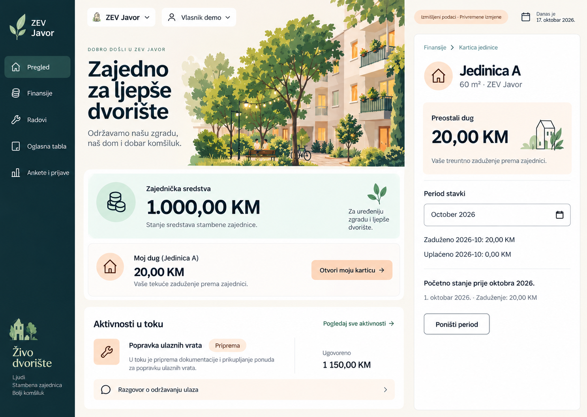

# ZEV — stil i plan „Živo dvorište“

Datum: 17. oktobar 2026. (Europe/Belgrade). Veza: DEV-02-J.

Korisnik je izabrao **drugu prikazanu verziju**, „Živo dvorište“. Ovaj dokument definiše stil i plan primjene u postojećem Next.js demou. Stil je odabran; vrijednosti ispod su konkretna izvedbena specifikacija koju treba provjeriti u implementaciji. Plan ne predstavlja implementiran UI niti odobrenje za backend ili objavljivanje.

## Vizuelna referenca i granice

Izvor je drugi stvarno prikazani Image Gen rezultat `exec-e80421e4-06c2-4ef0-963d-80242073fb60.png`. Kopija u ovom folderu je trajna projektna referenca. Slika prikazuje pregled i zasebnu karticu jedno pored drugog radi poređenja stila; finansijska kartica ostaje postojeća zasebna ruta, ne stalni desni panel.

Preuzeti: tamnu petrolej navigaciju, krem podlogu, ilustraciju dvorišta i zgrade, zelene i kajsija naglaske, krupne iznose i topao ton. Naziv proizvoda ostaje **ZEV**; „Živo dvorište“ je naziv dizajnerskog smjera, ne novi brend, logo ili naziv tenanta.

Sadržaj dolazi iz postojećeg demo konteksta. Generisana slika nije izvor iznosa, statusa ili pravila: početnih 20 KM duga A ne pretvarati u novo oktobarsko zaduženje. Lipa ima C i 500 KM; Javor A/B i 1.000 KM. Ne uvoditi univerzalnu stranicu „sve aktivnosti“, nove grafikone, oznake lokacije ili izmišljenu hronologiju. Ilustracija je simbol zajednice, ne fotografija stvarne zgrade.

## Karakter

Toplo, vedro i smireno. Živost dolazi iz ilustracije, jasne hijerarhije, boja površina i malih reakcija kontrola. Novac, obrasci i detalji ostaju precizni i čitljivi. Koristiti srpsku latinicu i postojeće formatere valute/datuma; native month kontrola može prikazivati jezik browsera.

## Paleta i semantički tokeni

Vrijednosti su početna izvedbena paleta, nisu očitane kao tačne boje svih piksela reference. Sve kombinacije provjeriti prije isporuke.

| Token | Vrijednost | Upotreba |
|---|---|---|
| canvas | `#FAF7F2` | Topla osnovna pozadina |
| surface | `#FFFFFF` | Forme, detalji i grupisane liste |
| ink | `#102D35` | Naslovi, iznosi i glavni tekst |
| muted | `#52636A` | Pomoćni tekst |
| sidebar | `#10343B` | Navigacija na desktopu |
| sidebar-active | `#28565A` | Aktivna destinacija uz tekst/oznaku |
| accent | `#185E54` | Glavna dugmad i veze |
| accent-hover | `#10483F` | Hover primarne radnje |
| mint-surface | `#EAF5EF` | Zajednička sredstva |
| peach-surface | `#FFF0E4` | Lična kartica i blagi topli naglasci |
| peach-action | `#F7C9A8` | Opciono istaknuta vlasnička prečica, uz ink tekst |
| line | `#DCE3DF` | Dekorativni razdjelnici |
| control | `#758781` | Vidljiva granica polja; potvrditi kontrast |
| danger | `#A52C25` | Greške i negativna upozorenja |
| success | `#216344` | Uspješan ishod, uz tekst |
| warning | `#80500E` | Status koji traži pažnju, uz tekst |
| focus | `#185E54` | Fokus na svijetlim površinama |
| focus-inverse | `#F7C9A8` | Fokus na tamnoj navigaciji |

Kajsija nije automatski oznaka duga niti zelena dokaz da je sve plaćeno. Dug, avans i nula uvijek imaju naziv. Ne koristiti bijeli sitan tekst na kajsija dugmetu. Dekorativni line nije jedina granica inputa. Ciljevi: običan tekst 4,5:1, veliki tekst 3:1, potrebne granice kontrola i fokus 3:1 u stvarnoj kombinaciji.

## Tipografija, razmaci i površine

- Postojeći sistemski sans font; bez novog font paketa. Osnovni tekst 16 px/1,5; pomoćni 14 px/1,5; nazivi sekcija 20–24 px/1,3.
- Naslov pregleda 40–48 px na desktopu, 30–34 px na telefonu. Veliki slogan i ilustracija pripadaju pregledu/landingu; detalji i forme koriste kratak naslov od 28–32 px.
- Glavni iznos 40–48 px, na telefonu 32–36 px, sa tabularnim ciframa. Ne smanjivati važnu informaciju radi duge dekorativne poruke.
- Skala razmaka: 4, 8, 12, 16, 24, 32, 48 px. Bočni padding 16 px na telefonu, 24–40 px na većem ekranu.
- Zaobljenja: kontrole 10–12 px, glavne grupisane površine 16–20 px. Umjerena linija ili blaga sjenka samo gdje olakšava razlikovanje.
- Obične liste koriste redove i razdjelnike. Izbjegavati karticu unutar kartice i pretvaranje svakog paragrafa u zaseban panel.

## Okvir i responzivnost

Na desktopu zadržati bočnu navigaciju približno 224–240 px, pet postojećih destinacija i naziv aktivnog ZEV-a. Koristiti dosljedne linijske ikone uz vidljive nazive. Ako nema odgovarajuće postojeće biblioteke, izbor malog licenciranog skupa riješiti u fazi J-B; bez ručnog crtanja ilustracija ili pretvaranja emoji simbola u ikone.

Zaglavlje sadrži aktivni ZEV i profil, kompaktne izbore, Demo prava i stalnu kratku napomenu o privremenim podacima. Reset i izlaz grupisati kao sekundarne demo radnje, uz očuvane potvrde i vidljivu dostupnost. Važne napomene ne smiju nestati iza tooltipa.

Mobilni prikaz zadržava označeno dugme Meni, aktivnu destinaciju i postojeće Escape/fokus ponašanje. Kontrole se prelamaju, podaci prelaze u jednu kolonu. Slika se smanjuje ili dobija manji zaseban prostor; nikad ne prekriva tekst. Na 320 px i sa 200% tekstom sadržaj ostaje čitljiv; široka tabela može imati svoj skrol.

## Primjena po ekranu

| Ekran | Sadržaj i vizuelna odluka |
|---|---|
| Pregled | Kratak pozdrav/naziv ZEV-a i ilustracija dvorišta. Najprije saldo evidencije sa datumom osnove na mint površini, zatim dozvoljena kartica na toploj površini. Radovi, posljednji troškovi, obavještenja i dozvoljene prijave ostaju dostupni; ne uklanjati podatke radi sličnosti sa slikom. |
| Kartica | Identitet jedinice i površina, jasno stanje Dug/Avans/Saldo, zatim period i odvojeni iznosi zaduženo/uplaćeno. Istorija i raspored kao čitljivi redovi. Mala ilustracija je opciona; bez dugmeta „Otvori moju karticu“ unutar već otvorene iste kartice. |
| Finansije i forme | Isti tokeni i tipografija; promet grupisan u redove, iznosi poravnati. Filteri kompaktni sa vidljivim labelama. Pregled prije potvrde, validacija, privatnost i prilozi ostaju funkcionalni. |
| Radovi i ponude | Status kao tekst i blagi naglasak. Ponude, ugovoreno i plaćeno jasno odvojeni; samo stvarni postojeći statusi, bez izmišljenog procenta napretka. |
| Oglasna tabla | Naslov, datum i sadržaj imaju jasnu hijerarhiju; diskretna ikona i topla površina. Ne simulirati društvenu mrežu novim reakcijama ili komentarima. |
| Ankete i prijave | Pitanje, rok i odgovor odvojeni od prijave i statusa. Fotografija je funkcionalni prilog; nema dekoracije oko polja koja odvlači pažnju. |
| Landing, prava, prazna stanja i UI pregled | Uskladiti boje, komponente i ton. Landing može imati izraženiju ilustraciju; pravo/nedostupnost zadržavaju jasno objašnjenje. Prazan modul i rezultat filtera ostaju različita stanja. |

Glavna radnja pregleda zavisi od profila: vlasnik otvara svoju karticu, operater dodaje trošak, korisnik prostora prijavljuje problem. Dizajn ne uvodi pristup tuđoj kartici.

## Ilustracije, ikone i pokret

Napraviti zaseban raster resurs dvorišta/zgrade bez ugrađenog UI teksta, inspirisan odabranom slikom. Sačuvati u projektu, npr. `apps/web/public/images/`, sa odgovarajućim dimenzijama i kompresijom. Cijeli mockup se ne koristi kao pozadina aplikacije i ne rasteže se kao implementacija. Dekorativna slika ima prazan alt; važna informacija uvijek postoji kao HTML tekst. Logotip ZEV-a ne mijenjati bez zasebnog dogovora.

Hover/fokus/prelazi oko 120–180 ms; bez parallaxa, brojanja novca i stalnog pomjeranja ilustracija. Poštovati `prefers-reduced-motion`. Finansijska potvrda prikazuje stvarni lokalni rezultat bez lažnog spinnera.

## Plan primjene i kriterijumi završetka

Planirane implementacione stavke ne predstavljaju izvršenu doradu. Implementacija J-B–J-E odobrena je naknadnim nalogom u ovom chatu; korisnikovo prihvatanje vodi se odvojeno.

| ID | Korak | Zavisnost | Kriterijum završetka |
|---|---|---|---|
| DEV-02-J-A | Stil, referenca i plan | Korisnikov izbor verzije 2 | Ovaj dokument, sačuvana tačna referenca, razlike slike i poslovnih podataka i povezane smjernice pregledani. |
| DEV-02-J-B | Tokeni, osnovne komponente i resursi | J-A | Tokeni u `global.css`, Button/TextField/Notice/PageHeading ujednačeni; ilustracija i ikone lokalno dostupni; kontrast izmjeren. |
| DEV-02-J-C | Okvir, pregled i kartica | J-B | `demo-frame`, navigacija/kontrole, pregled i `finances/finance-details` prate smjer; vlasnik/operater/korisnik prostora i Javor/Lipa rade kao prije; desktop i mobilni screenshotovi. |
| DEV-02-J-D | Ostale cjeline i landing | J-C | Finansijske liste/forme, radovi, community prikazi, landing i `/ui` koriste isti jezik; ne ostaju stare plave/hladne komponente bez razloga. |
| DEV-02-J-E | Provjera i korisnikov pregled | J-D | Lint/typecheck/build, ručne provjere pogođenih tokova, kontrasta, tastature, fokusa i reflowa; poređenje reference i implementacije u istom pregledu; zabilježene razlike i korisnikov ishod. |

Raditi u postojećem `apps/web`; nema nove aplikacije ili ponovne inicijalizacije workspace-a. Zajedničke tokene i male komponente koristiti umjesto dupliranja CSS-a po ekranima. Reducer, selektori i čista finansijska pravila mijenjaju se samo ako postoji posebno dogovoren funkcionalni razlog.

## Provjera implementacije

- Reprezentativni prikazi na 320, 360, 768 i 1280/1440 CSS px; 200% tekst, duži nazivi i veći iznosi. Bez odsijecanja važnih kontrola i brojeva.
- Tastatura, vidljiv fokus na tamnoj/svijetloj podlozi, Meni, Escape, native dijalozi i povrat fokusa; validacioni sažeci i programske veze sa poljima.
- Oba ZEV-a i sva tri profila: kartice, skrivene operaterske radnje, prazna stanja, čuvanje nacrta/odbacivanje i reset.
- Pogođeni tokovi: finansijski pregled i potvrda, obračun bez dupliranja, povezani trošak rada, objava, prijava sa lokalnom fotografijom i anketa. Raniji H ostaje dokaz prethodne verzije; ne tvrditi da automatski provjerava novi raspored.
- Postojeće lint/typecheck/build komande uz Node 22.22.1 i Corepack pnpm; bez novih testova, frameworka ili testne infrastrukture.
- Izvještaj navodi stvarno provjerene scenarije i granice. Screenshot nije dokaz potpune pristupačnosti ili produkcione kontrole pristupa.

## Status ovog dokumenta

J-B–J-D su implementirani i provjereni u obimu [izvještaja](../../design-qa.md). J-E ima završen tehnički/ručni dio, a stvarni korisnikov pregled ostaje otvoren; DEV-02-J i zbirna DEV-02 ostaju U TOKU. Backend, stvarni nalozi, trajna pohrana i objavljivanje ostaju van ovog zadatka.
